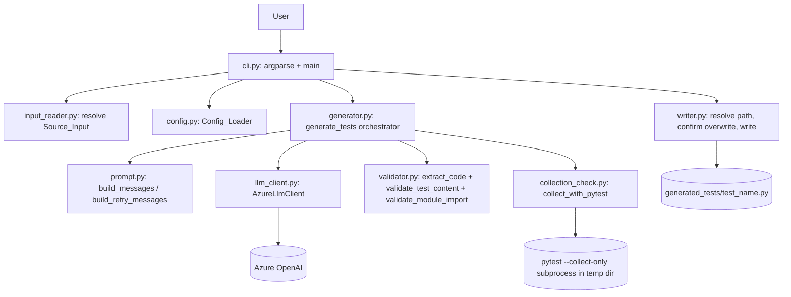
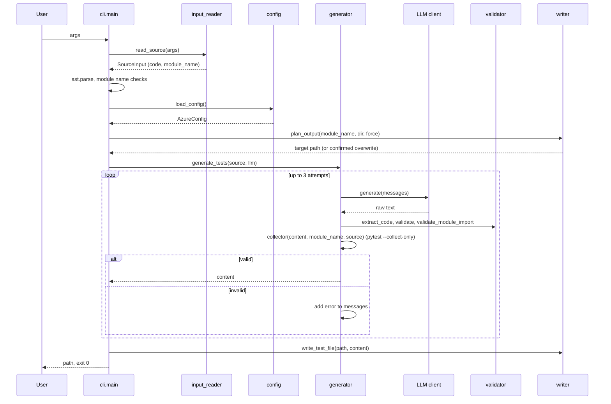

# Design Document

## Overview

The Pytest Test Generator Agent is a Python CLI that reads Python source (file, `--snippet`, or stdin), asks an Azure OpenAI chat deployment through LangChain to write a pytest file, cleans and validates the answer, and writes `test_<name>.py` to an output directory. The project is personal and educational, so the design favors a small, flat package with pure functions at the core and thin I/O edges.

Key design decisions:

- **Four single-responsibility modules** (config, prompt, LLM client, validator) that import independently (Req 8.5). The orchestrator is the only place that wires them together.
- **Pure core, impure edges.** Fence extraction, validation, naming and prompt building are pure functions, so they are property-testable without network access. Only `llm_client.py` talks to Azure and only `cli.py`/`writer.py` touch stdin, the terminal and the file system.
- **Fail before calling the LLM.** All input checks (path, emptiness, syntax via `ast.parse`, module name, config) run first, so invalid runs never cost an API call.
- **Dependency injection for the LLM.** The orchestrator receives an object with a `generate(messages) -> str` method. Tests pass a fake; production passes `AzureLlmClient`.
- **Typed domain errors** (`AgentError` subclasses) carry a Portuguese message and an exit code. `cli.main` is the single place that prints errors and exits.
- **argparse** for the CLI (standard library, Portuguese help text through `description`/`help` strings, automatic usage on unknown or missing arguments, exit code 2). The parser is created with `allow_abbrev=False`, so `--forc` or `--out` are rejected instead of silently matching `--force` or `--output-dir`.
- **Import check and collection check after validation.** After the pure validation passes, the generator checks that the content imports the target module and then runs `pytest --collect-only` in a subprocess on a temporary directory. The subprocess runner is an injectable function, so the generation loop is testable without any subprocess.
- **Atomic, validated writes.** Nothing is written unless validation passes, so failures never leave partial or modified files.

### Research summary

- `langchain_openai.AzureChatOpenAI` accepts `azure_endpoint`, `api_key`, `api_version`, `azure_deployment`, `temperature`, `timeout` and `max_retries`. Setting `timeout=60` and `max_retries=0` gives the 60 s limit of Req 2.7 without hidden SDK retries. The underlying `openai` SDK raises `AuthenticationError`, `APIConnectionError`, `APITimeoutError` and `RateLimitError`, which map to the error categories in Req 2.6 and 2.7. See the [LangChain Azure OpenAI integration docs](https://python.langchain.com/docs/integrations/chat/azure_chat_openai/).
- `python-dotenv`'s `load_dotenv(override=False)` keeps existing process variables over `.env` values, which is exactly Req 5.3.
- Property-based testing library: [Hypothesis](https://hypothesis.readthedocs.io/). It is a dev dependency listed in `requirements.txt` alongside `pytest`. Req 8.1 lists five required lines, each with a compatible version range (see Dependency pinning below).
- `argparse.ArgumentParser(allow_abbrev=False)` disables prefix matching of long options. Abbreviations then fall through to the unrecognized-arguments error, which `PtArgumentParser.error()` already turns into the Portuguese message with exit code 2. See the [argparse documentation](https://docs.python.org/3/library/argparse.html#allow-abbrev).
- `pytest --collect-only` imports the test module and everything it imports, reports import errors as collection errors and exits non-zero (status 2 for errors, 5 when nothing is collected), without running any test. It needs no network. See the [pytest usage documentation](https://docs.pytest.org/en/stable/how-to/usage.html).
- GitHub Actions does not expose secrets to the `if:` expression of a step directly. The usual pattern is to copy the secret into a job-level `env` variable and test `env.NAME != ''`. Secrets are also not passed to workflows triggered by pull requests from forks, so the step is skipped there. See the [GitHub Actions secrets documentation](https://docs.github.com/en/actions/security-for-github-actions/security-guides/using-secrets-in-github-actions).
- Network blocking in tests: an autouse fixture in `tests/conftest.py` replaces `socket.socket.connect` (and `socket.create_connection`) with a function that raises `AssertionError("acesso à rede não permitido")` (Req 9.7). This avoids an extra dependency.

Content was rephrased for compliance with licensing restrictions.

## Architecture

### Layers and data flow



### Main sequence



The overwrite confirmation happens before the LLM call so the user does not pay for a generation they will refuse (Req 4.9, 4.12). The existing file is only replaced after validation succeeds.

### Package layout

```
Azure-LangChain/
├── pytest_agent/            # Agent package (no examples inside)
│   ├── __init__.py
│   ├── __main__.py          # python -m pytest_agent
│   ├── cli.py
│   ├── errors.py
│   ├── input_reader.py
│   ├── config.py
│   ├── prompt.py
│   ├── llm_client.py
│   ├── validator.py
│   ├── collection_check.py
│   ├── generator.py
│   └── writer.py
├── examples/
│   ├── calculadora.py       # add, subtract
│   ├── divisao.py           # divide (raises ValueError)
│   └── generated_tests/
│       ├── test_calculadora.py
│       └── test_divisao.py
├── tests/                   # Agent's own tests
│   ├── conftest.py          # network blocker, env cleaner
│   └── test_*.py
├── .github/
│   └── workflows/
│       └── ci.yml           # GitHub Actions: pytest + optional forbidden names check
├── images/                  # optional screenshots
├── .env.example
├── .gitignore
├── pyproject.toml           # pytest config (pythonpath, testpaths)
├── requirements.txt
└── README.md                # pt-BR
```

Notes:

- `.gitignore` excludes `generated_tests/`. The committed example tests live in `examples/generated_tests/`, so the ignore pattern must be anchored: `/generated_tests/` (root only). Examples are then not ignored.
- `pyproject.toml` sets `[tool.pytest.ini_options] pythonpath = [".", "examples"]` and `testpaths = ["tests", "examples"]`. Pytest 7+ supports `pythonpath`, so example modules import without `PYTHONPATH` or `sys.path` edits (Req 6.5). Because `examples/generated_tests/` has no `__init__.py` and file names are unique, rootdir-based import works.
- The README commands for examples are, from the repository root:
  `python -m pytest_agent examples/calculadora.py --output-dir examples/generated_tests`
  `python -m pytest_agent examples/divisao.py --output-dir examples/generated_tests`
  The generated tests import `calculadora` and `divisao` (Req 2.4), which resolve through `pythonpath`.

## Components and Interfaces

### errors.py

```python
class AgentError(Exception):
    exit_code: int = 1
    # message is already localized (pt-BR)

class InputError(AgentError): ...        # Req 1.4-1.8, 4.3, 4.4
class ConfigError(AgentError): ...       # Req 5.4
class LlmError(AgentError): ...          # Req 2.6-2.8 (category attribute)
class ValidationFailedError(AgentError): ...  # Req 3.8
class OutputError(AgentError): ...       # Req 4.8, 4.12
```

### cli.py

```python
def build_parser() -> argparse.ArgumentParser
def main(argv: list[str] | None = None, *, llm_factory=AzureLlmClient.from_config,
         stdin=sys.stdin, stdout=sys.stdout, stderr=sys.stderr) -> int
```

Arguments (all help text in Portuguese):

| Argument | Meaning |
|---|---|
| `arquivo` (positional, optional) | Path to a `.py` file |
| `--snippet TEXTO` | Code passed inline |
| `--module-name NOME` | Module name, required for snippet/stdin |
| `--output-dir DIR` | Output directory, default `generated_tests/` |
| `--force` | Overwrite without asking |
| `-h/--help` | Portuguese usage, exit 0 |

Behavior: `main` catches `AgentError`, prints the message to stderr and returns its exit code. argparse errors are produced by a subclass `PtArgumentParser(argparse.ArgumentParser)` that overrides `error()` to print a Portuguese message plus usage and exit with code 2 (Req 8.7). `build_parser` passes `allow_abbrev=False` to the constructor, so an abbreviation such as `--forc` is reported as an unrecognized argument and the message names the rejected token (Req 8.8). Full option names keep working (Req 8.9). `main` also receives a `collector` parameter (default `collect_with_pytest`) that it passes to `generate_tests`. Order of checks, all before any LLM call: single input source, read source, non-empty, `ast.parse`, module name, config. Stdin is read only when neither file nor `--snippet` is given and stdin is not a TTY; a TTY with no input source is a missing-argument error.

### input_reader.py

```python
@dataclass(frozen=True)
class SourceInput:
    code: str
    module_name: str | None   # stem of file, or --module-name

def read_source(file: str | None, snippet: str | None, stdin) -> tuple[str, Path | None]
def check_source(code: str) -> None          # empty and ast.parse checks
def resolve_module_name(file: Path | None, module_name: str | None) -> str
def is_valid_module_name(name: str) -> bool  # ^[A-Za-z_][A-Za-z0-9_]{0,99}$
```

`read_source` counts sources: file given, snippet given, and (only when neither is given) stdin content. If a file and snippet are both given, or either is given while stdin carries piped content, raise `InputError`. To detect piped stdin content without blocking, stdin is read only if it is not a TTY, and non-empty piped content together with another source is an error. Files are opened with `encoding="utf-8"`; `FileNotFoundError`, `PermissionError`, `IsADirectoryError` and `UnicodeDecodeError` each become an `InputError` naming the path and reason. `check_source` reports `SyntaxError` with `lineno`.

### config.py (Config_Loader)

```python
@dataclass(frozen=True)
class AzureConfig:
    api_key: str = field(repr=False)
    endpoint: str
    api_version: str
    deployment_name: str

REQUIRED_VARS = ("AZURE_OPENAI_API_KEY", "AZURE_OPENAI_ENDPOINT",
                 "AZURE_OPENAI_API_VERSION", "AZURE_OPENAI_DEPLOYMENT_NAME")

def load_config(env: Mapping[str, str] | None = None, dotenv_path: Path | None = None) -> AzureConfig
```

When `env` is `None`, it calls `load_dotenv(dotenv_path or Path.cwd()/".env", override=False)` and reads `os.environ`. When `env` is a mapping (tests), no file or global state is touched. Missing, empty or whitespace-only variables are collected in declaration order and reported together with the text mentioning `.env.example`. `api_key` uses `repr=False`, and no code formats the key into any message (Req 5.6).

### prompt.py

```python
SYSTEM_PROMPT: str
def build_messages(source_code: str, module_name: str) -> list[Message]
def build_retry_messages(previous: list[Message], bad_output: str, error: str) -> list[Message]
```

`Message` is a simple `(role, content)` dataclass so the module does not import LangChain. The system prompt (written in English for model quality; it is not user-facing) instructs the model to: generate pytest tests; start with `import pytest`; import the code under test with `from <module_name> import ...`; write at least one success and one failure test (using `pytest.raises`) per public module-level function (name not starting with `_`); return only Python code, no Markdown fences, no text outside code or comments. The user message contains the source in a delimited block and the module name. The retry builder appends the invalid output as an assistant message and the validation error as a user message asking for a corrected full file.

### llm_client.py

```python
class LlmClient(Protocol):
    def generate(self, messages: list[Message]) -> str: ...

class AzureLlmClient:
    def __init__(self, config: AzureConfig, temperature: float = 0.0, timeout_s: float = 60.0)
    def generate(self, messages) -> str
```

Internally builds `AzureChatOpenAI(azure_endpoint=..., api_key=..., api_version=..., azure_deployment=..., temperature=0, timeout=60, max_retries=0)` and converts `Message` to LangChain `SystemMessage`/`HumanMessage`/`AIMessage`. Exception mapping:

| Exception | LlmError category | Portuguese message names |
|---|---|---|
| `AuthenticationError`, `PermissionDeniedError` | `autenticação` | authentication |
| `APITimeoutError` | `timeout` | the 60-second limit |
| `APIConnectionError` | `rede` | network |
| `RateLimitError` (quota) | `cota` | quota |

The mapping function `map_exception(exc) -> LlmError` is separate and pure so it can be unit-tested with synthetic exceptions. Messages never include `config.api_key`; the raw exception text is not echoed, because SDK errors can include request details. An empty or whitespace-only response is turned into `LlmError(category="vazio")` by the orchestrator, not by the client.

### validator.py (Output_Validator)

```python
def extract_code(raw: str) -> str
def validate_test_content(content: str) -> ValidationResult

@dataclass(frozen=True)
class ValidationResult:
    ok: bool
    error: str | None
```

`extract_code` rules, applied in order:

1. If the text has a fenced block (a line starting with three backticks, optional language tag, up to the next closing fence line), return the inside of the first block, excluding fence lines. An unclosed fence takes the rest of the text.
2. Otherwise, drop everything before the first line equal to `import pytest` (after stripping trailing whitespace). If no such line exists, return the text unchanged so validation reports the problem.
3. When both apply, the fence rule runs first and the `import pytest` trim then runs on the extracted block (this makes the function idempotent).

`validate_test_content` checks, in this order, returning the first failure:

1. First line is exactly `import pytest` (no leading blank lines or whitespace).
2. `ast.parse` succeeds.
3. At least one top-level `def test_*` (sync or async) or a `test_*` method inside a top-level class.
4. At least one failure assertion: a `with pytest.raises(...)`, `with pytest.warns(...)` or a call to `pytest.fail(...)`, detected by walking the AST for `With` items and `Call` nodes whose func is the attribute `raises`/`warns`/`fail` on name `pytest`.

Error strings are Portuguese and are fed back to the model in retries.

Additional pure check for the target module import (Req 3.11):

```python
def validate_module_import(content: str, module_name: str) -> ValidationResult
```

It parses `content` with `ast.parse` and walks only `tree.body` (top-level statements). It returns `ok` if and only if some statement is an `ast.ImportFrom` with `level == 0` and `module == module_name`. Imports nested in functions, `import <module_name>` and relative imports do not count, because the prompt asks for `from <module_name> import ...` (Req 2.4). If the content does not parse, it returns a failure with the syntax message (the generator never calls it before `validate_test_content` passes). The error string is Portuguese and names the expected line, for example `o arquivo de teste deve conter "from calculadora import ..."`.

### collection_check.py (Collection_Check)

```python
@dataclass(frozen=True)
class CollectionResult:
    ok: bool
    output: str = ""          # summarized pytest output, empty when ok

Collector = Callable[[str, str, str], CollectionResult]   # (test_content, module_name, source_code)

COLLECT_TIMEOUT_S = 30.0

def build_collect_command(python_exe: str, test_path: str, ini_path: str) -> list[str]
def summarize_output(text: str, max_lines: int = 20, max_chars: int = 2000) -> str
def build_collect_env(base: Mapping[str, str]) -> dict[str, str]
def collect_with_pytest(test_content: str, module_name: str, source_code: str, *,
                        timeout_s: float = COLLECT_TIMEOUT_S, run=subprocess.run) -> CollectionResult
```

How it works, offline and without touching the project directory:

1. Create a `tempfile.TemporaryDirectory()` (removed in a `finally`, Req 3.16).
2. Write `<module_name>.py` (the Source_Input code, UTF-8), `test_<module_name>.py` (the generated content, UTF-8) and an empty `pytest.ini` into it. The empty ini file fixes the rootdir and stops pytest from reading the project's `pyproject.toml`. pytest's default `prepend` import mode puts the test file's directory on `sys.path`, so `from <module_name> import ...` resolves to the temporary copy and no `PYTHONPATH` is needed.
3. Run `build_collect_command(sys.executable, ...)` = `[python, "-m", "pytest", "--collect-only", "-q", "-p", "no:cacheprovider", "-c", <ini>, <test file>]` with `cwd` set to the temporary directory, `capture_output=True`, `text=True`, `timeout=timeout_s` and `env=build_collect_env(os.environ)`.
4. `build_collect_env` copies the environment, removes every `AZURE_OPENAI_*` variable and sets `PYTHONDONTWRITEBYTECODE=1` (Req 3.15).
5. Exit code 0 gives `CollectionResult(ok=True)`. Any other code gives `ok=False` with `summarize_output(stdout + stderr)`, which keeps the last 20 lines, at most 2000 characters, so the retry prompt stays small (Req 3.13).
6. `subprocess.TimeoutExpired` gives `ok=False` with a Portuguese message that states the 30-second limit (Req 3.14). `OSError` when starting the process gives `ok=False` with a Portuguese message naming the reason.

Why a subprocess and not `pytest.main()` in-process: collection imports modules into `sys.modules`, so an in-process run would leak modules between attempts and between tests (a second attempt could see the first attempt's `calculadora`). A subprocess gives a clean interpreter each time and lets the timeout kill a hanging import. The cost is about one second per attempt, which is small next to an LLM call.

Testability: the generator receives the collector as a parameter (`Collector`). Unit tests inject `lambda *_: CollectionResult(True)` or a failing fake and never start a process. `build_collect_command`, `build_collect_env` and `summarize_output` are pure. `collect_with_pytest` accepts `run=` so a test can inject a fake `subprocess.run` that returns a `CompletedProcess` or raises `TimeoutExpired`. Two integration tests run the real subprocess on small inline contents: one valid import and one import of a missing name (Req 9.9). The network guard fixture only patches the test process, which is acceptable because pytest collection does not open connections.

Security note: collection imports the Source_Input module and the generated file, so their top-level code runs. The Source_Input is the user's own code, and the generated file is checked by the validator for syntax first. The README safety note already tells the user to review generated tests. The subprocess has a 30-second limit, a temporary working directory and no Azure variables, which limits the damage from a mistake but is not a sandbox.

### generator.py

```python
MAX_RETRIES = 2

def generate_tests(source_code: str, module_name: str, llm: LlmClient,
                   collector: Collector = collect_with_pytest) -> str
```

Loop of at most `1 + MAX_RETRIES` attempts: call `llm.generate`; if the raw response is blank raise `LlmError("vazio")` immediately (Req 2.8, no retry, since this is a service-level anomaly, not a content error); `extract_code`; `validate_test_content`; if ok, `validate_module_import(content, module_name)`; if ok, `collector(content, module_name, source_code)`; on success return the cleaned content; on any failure (including a failed `CollectionResult`, whose `output` becomes the error text) build retry messages and continue. The checks run in this order so the cheap pure checks fail first and the subprocess only runs on content that already parses and imports the target. After the last failure raise `ValidationFailedError` including the last error. `LlmError` from the client propagates without retry.

### writer.py

```python
def build_test_file_name(module_name: str) -> str      # "test_<name>.py"
def resolve_target(output_dir: Path, module_name: str) -> Path
def check_overwrite(target: Path, force: bool, is_interactive: bool, ask: Callable[[str], str]) -> None
def write_test_file(target: Path, content: str) -> None
```

- `check_overwrite` does nothing if the target does not exist or `force` is true. If it exists, not forced and interactive, it asks `[s/N]`; only `s`/`sim` (case-insensitive) proceeds, anything else raises `OutputError` "operação cancelada" with non-zero exit and leaves the file unchanged. If not interactive (`not sys.stdin.isatty()` or `EOFError` on prompt), it raises `OutputError` stating the file exists and `--force` is required (Req 4.12).
- `write_test_file` creates parents (`mkdir(parents=True, exist_ok=True)`), writes to a temporary file in the same directory (`encoding="utf-8"`, `newline="\n"`), then `os.replace` onto the target. `OSError` becomes `OutputError` naming the directory and reason.
- The file is opened with `newline=""` so no line-ending translation happens on any platform. Reading it back with `newline=""` returns text identical to the validated content (Req 3.10).

### Interface to the examples

Example modules are plain functions with type hints and docstrings:

```python
# examples/calculadora.py
def add(a: float, b: float) -> float: ...
def subtract(a: float, b: float) -> float: ...

# examples/divisao.py
def divide(a: float, b: float) -> float:   # raises ValueError if b == 0
```

Committed tests are generated by the Agent, then reviewed by the owner before commit. A repository check script (or test) verifies each example test file covers every function and contains `pytest.raises(ValueError)` for `divide`.

## Data Models

```python
@dataclass(frozen=True)
class Message:
    role: Literal["system", "user", "assistant"]
    content: str

@dataclass(frozen=True)
class SourceInput:
    code: str
    module_name: str            # validated identifier
    from_file: bool

@dataclass(frozen=True)
class AzureConfig:
    api_key: str = field(repr=False)
    endpoint: str
    api_version: str
    deployment_name: str

@dataclass(frozen=True)
class ValidationResult:
    ok: bool
    error: str | None = None

@dataclass(frozen=True)
class CollectionResult:
    ok: bool
    output: str = ""
```

Dependency pinning (`requirements.txt`, one package per line, versions installed when the spec was updated, checked with `pip list`):

```
langchain>=1.5.0,<2
langchain-openai>=1.8.1,<2
python-dotenv>=1.2.4,<2
pytest>=9.2.0,<10
hypothesis>=6.170.15,<7
```

The lower bound is the version known to work with the test suite; the exclusive upper bound is the next major version, where breaking changes are allowed by semantic versioning. `tests/test_repo_layout.py` parses each line with a regular expression for the package name and checks the presence of both bounds, instead of comparing whole lines, so a future bump of the numbers does not break the test.

CI workflow (`.github/workflows/ci.yml`):

```yaml
name: CI
on:
  push:
  pull_request:
permissions:
  contents: read
jobs:
  test:
    runs-on: ubuntu-latest
    env:
      FORBIDDEN_NAMES: ${{ secrets.FORBIDDEN_NAMES }}
    steps:
      - uses: actions/checkout@v4
      - uses: actions/setup-python@v5
        with:
          python-version: "3.12"
          cache: pip
      - run: pip install -r requirements.txt
      - run: python -m pytest
      - name: Verificar nomes proibidos
        if: ${{ env.FORBIDDEN_NAMES != '' }}
        run: |
          printf '%s\n' "$FORBIDDEN_NAMES" > "$RUNNER_TEMP/forbidden_names.txt"
          FORBIDDEN_NAMES_FILE="$RUNNER_TEMP/forbidden_names.txt" python scripts/check_forbidden_names.py
```

Decisions: the secret is exposed only through `env` and never interpolated into the shell script text, so it is not written to the log (GitHub also masks secret values). The job defines no `AZURE_OPENAI_*` variable, so the suite runs exactly as it does locally without credentials (Req 9.6). Pull requests from forks receive an empty secret, so the step is skipped and does not fail (Req 10.7). The `contents: read` permission is the least privilege needed for checkout (Req 10.8). Action versions `v4` and `v5` are major-version tags; pinning to commit SHAs is possible but not required for this personal project. A single Python version is used to keep the workflow small; a matrix can be added later.

Environment template (`.env.example`), one variable per line with a Portuguese comment and placeholder values:

```
# Chave de API do recurso Azure OpenAI (nunca versione a chave real)
AZURE_OPENAI_API_KEY=sua-chave-aqui
# URL do endpoint do recurso, ex.: https://meu-recurso.openai.azure.com/
AZURE_OPENAI_ENDPOINT=https://seu-recurso.openai.azure.com/
# Versão da API usada nas chamadas
AZURE_OPENAI_API_VERSION=2024-06-01
# Nome do deployment do modelo de chat criado no Azure
AZURE_OPENAI_DEPLOYMENT_NAME=nome-do-seu-deployment
```

Exit codes: `0` success; `1` domain errors (`AgentError`); `2` argparse usage errors.

README outline (pt-BR, 12 headings): Descrição do projeto, Funcionalidades, Visão geral da arquitetura, Pré-requisitos, Instalação, Configuração das variáveis de ambiente, Como executar o Agente, Exemplos de uso, Como rodar os testes com pytest, Estrutura do projeto, Notas de segurança, Licença. Installation is a numbered list with PowerShell and bash commands for venv creation, activation, `pip install -r requirements.txt` and copying `.env.example` to `.env`. The variable table gives purpose and the Azure portal location (key and endpoint under "Keys and Endpoint" of the Azure OpenAI resource; deployment name under the deployments page in Azure AI Foundry; API version from the API reference). Screenshots, if any, use ``. No bootcamp or course platform name appears in any repository file; this is checked by a pre-commit script (see Testing Strategy).

## Correctness Properties

*A property is a characteristic or behavior that should hold true across all valid executions of a system-essentially, a formal statement about what the system should do. Properties serve as the bridge between human-readable specifications and machine-verifiable correctness guarantees.*

PBT applies to the pure core of this feature (fence extraction, validation, naming, prompt building, config loading, input checks). It does not apply to the Azure call itself, the README, the `.gitignore`, the examples, or packaging, which are covered by example, smoke and integration tests.

### Property 1: UTF-8 file input round trip

For any text, writing it to a `.py` file as UTF-8 and reading it with `read_source` returns exactly that text.

**Validates: Requirements 1.1**

### Property 2: Blank input is rejected before any LLM call

For any string made only of whitespace characters, `check_source` raises `InputError`, and running the CLI with that string as the snippet exits non-zero with zero LLM calls.

**Validates: Requirements 1.5**

### Property 3: Prompt carries the source and module name

For any source code string and valid module name, the messages built by `build_messages` contain the source code verbatim and the module name that the model must import from.

**Validates: Requirements 2.1, 2.4**

### Property 4: Blank model responses are treated as errors

For any model response made only of whitespace, `generate_tests` raises `LlmError` of category "vazio" after exactly one LLM call, and no Test_File is written.

**Validates: Requirements 2.8**

### Property 5: Validator accepts content exactly when all conditions hold

For any generated content built from a choice of (first line is exactly `import pytest` or a variant with leading whitespace or blank lines), (parses or has an appended syntax error), (zero or more `test_` functions or class methods) and (failure construct from `pytest.raises`, `pytest.warns`, `pytest.fail`, or none), `validate_test_content` returns `ok` if and only if the first line is exactly `import pytest`, the content parses, there is at least one `test_` function, and a failure construct is present.

**Validates: Requirements 3.1, 3.2, 3.3, 3.9**

### Property 6: Prose before the import line is removed

For any sequence of text lines none of which equals `import pytest` and which contain no fence line, prepending them to valid test content and applying `extract_code` returns the valid test content unchanged.

**Validates: Requirements 3.5**

### Property 7: Written content reads back identically

For any validated content (including non-ASCII characters and either `\n` or `\r\n` line endings), `write_test_file` followed by reading the file as UTF-8 returns text identical to the content.

**Validates: Requirements 3.6, 3.10**

### Property 8: Test file naming

For any valid module name `n`, whether it comes from a file stem or from `--module-name`, `build_test_file_name(n)` equals `test_<n>.py`.

**Validates: Requirements 4.1, 4.2**

### Property 9: Module name validation matches the identifier rule

For any string, `is_valid_module_name` returns true if and only if the string has 1 to 100 characters, uses only ASCII letters, digits and underscores, and does not start with a digit. When false, the CLI exits non-zero and creates no file.

**Validates: Requirements 4.4**

### Property 10: Config loading returns the supplied values

For any four non-blank strings assigned to the four required variables, `load_config` returns an `AzureConfig` with those exact values.

**Validates: Requirements 5.1**

### Property 11: Missing or blank variables are all reported

For any non-empty subset of the four variables that is missing, empty or whitespace-only, `load_config` raises `ConfigError` whose message lists exactly the names in that subset and mentions `.env.example`, and the CLI makes zero LLM calls and exits with status 1.

**Validates: Requirements 5.4**

### Property 12: The API key never appears in output

For any API key string of at least 8 characters, running the CLI through every failure path (input, config, LLM auth/network/quota/timeout, validation failure, output error) produces no standard output, standard error, log record, exception message or `repr(config)` that contains the key.

**Validates: Requirements 5.6**

### Property 13: Fence wrapping round trip

For any valid Python code string and any optional language tag, wrapping the code in a Markdown fenced block and applying `extract_code` returns the original code.

**Validates: Requirements 3.4, 9.4**

### Property 14: Fence extraction is idempotent

For any text (arbitrary, or fence-wrapped), `extract_code(extract_code(x))` equals `extract_code(x)`.

**Validates: Requirements 9.5**

### Property 15: Unknown arguments and option abbreviations are rejected without an LLM call

For any argument name that is not a supported option, and for any proper prefix (at least one character after `--`) of a supported long option (`--snippet`, `--module-name`, `--output-dir`, `--force`, `--help`), the CLI prints a Portuguese error that names the rejected token and the usage, exits with code 2, and makes zero LLM calls. For each supported long option written in full, the parser accepts it.

**Validates: Requirements 8.7, 8.8, 8.9**

### Property 16: Module import check matches the top-level import rule

For any valid module name `n` and any test content that parses, `validate_module_import(content, n)` returns ok if and only if a top-level statement of the content is `from n import ...` with no relative level. Contents that import `n` only inside a function, with `import n`, or import another module name are rejected.

**Validates: Requirements 3.11**

### Property 17: Collection failures feed the retry loop

For any sequence of LLM responses that pass the pure validation and any sequence of collector results (ok or failed with an arbitrary output text), `generate_tests` makes `min(k, 3)` LLM calls and `min(k, 3)` collector calls, where `k` is the 1-based index of the first ok result, and returns the content of that attempt when `k <= 3`. When no result among the first 3 is ok, it raises `ValidationFailedError` whose message contains the last failed output, and each retry message list contains the summarized output of the previous failure.

**Validates: Requirements 3.7, 3.8, 3.12, 3.13, 9.8**

### Property 18: Collector output summary is bounded

For any text, `summarize_output(text)` returns at most 20 lines and at most 2000 characters, and the result is a suffix of the input text with trailing whitespace removed (the last lines are kept). Applying it twice gives the same result as applying it once.

**Validates: Requirements 3.13**

## Error Handling

| Situation | Exception | Message language | Exit code | Side effects |
|---|---|---|---|---|
| Missing/unreadable file, empty input, syntax error, multiple sources | `InputError` | pt-BR | 1 | none, no LLM call |
| Snippet or stdin without module name; invalid module name | `InputError` | pt-BR | 1 | none |
| Missing/blank env variables | `ConfigError` | pt-BR, lists names | 1 | none, no LLM call |
| Authentication, network, quota | `LlmError` with category | pt-BR names category | 1 | no file |
| 60 s timeout | `LlmError("timeout")` | pt-BR states 60 s | 1 | no file |
| Blank model response | `LlmError("vazio")` | pt-BR | 1 | no file |
| Validation fails after 3 attempts | `ValidationFailedError` | pt-BR + last error | 1 | existing file untouched |
| Content does not import the target module (`from <module_name> import ...`) | validation error inside the retry loop | pt-BR | 1 after 3 attempts | existing file untouched |
| `pytest --collect-only` fails (broken import, collection error, no tests) | validation error with summarized output inside the retry loop | pt-BR + last 20 lines of pytest output | 1 after 3 attempts | temp dir removed, existing file untouched |
| Collection exceeds 30 s or the subprocess cannot start | validation error inside the retry loop | pt-BR states the limit or reason | 1 after 3 attempts | temp dir removed |
| Output dir not creatable/writable | `OutputError` | pt-BR with path | 1 | none |
| File exists, no `--force`, not interactive | `OutputError` | pt-BR, mentions `--force` | 1 | existing file untouched |
| User declines overwrite | `OutputError` | pt-BR | 1 | existing file untouched |
| Unknown or missing argument, or abbreviated long option (`--forc`) | argparse error | pt-BR names the token + usage | 2 | none |
| Ctrl+C | `KeyboardInterrupt` caught in `main` | pt-BR | 130 | temp file removed |

Principles: a single handler in `cli.main` prints errors to stderr; secrets are never interpolated into messages; raw SDK exception text is not echoed; temporary files are removed in a `finally` block so a failed write never leaves a partial Test_File.

## Testing Strategy

### Approach

Both unit tests and property tests are used. Property tests cover the pure core; example tests cover specific scenarios, error paths and integration points. All tests run offline.

- **Framework**: pytest. **Property library**: [Hypothesis](https://hypothesis.readthedocs.io/); no property-based testing is implemented from scratch.
- **Configuration**: each property test uses `@settings(max_examples=100)` at minimum (`max_examples=200` for the fence and validator properties). Each test carries a comment tag in the format `# Feature: pytest-test-generator-agent, Property N: <title>`. Each property is implemented by exactly one property-based test.
- **Fake LLM**: `FakeLlm(responses: list[str])` records calls (`calls` list) and returns the next response, repeating the last. A variant raises a configured exception.
- **Isolation fixtures** (`tests/conftest.py`):
  - autouse `block_network` replaces `socket.socket.connect` and `socket.create_connection` with a function raising `AssertionError("acesso à rede não permitido")` (Req 9.2, 9.7);
  - autouse `clean_azure_env` deletes the four `AZURE_OPENAI_*` variables with `monkeypatch.delenv`;
  - `tmp_path` is used for every file operation; tests run with `cwd` set to `tmp_path` when `.env` matters.
- Hypothesis function-scoped fixture warnings are avoided by using `tmp_path_factory` or `tempfile` inside the test body for file properties (Properties 1 and 7).

### Unit and example tests (by area)

- **Input**: file read, snippet, stdin via `io.StringIO`; missing path, directory path, invalid UTF-8 bytes, syntax errors with line number, source-combination conflicts (Req 1.2-1.4, 1.6-1.8).
- **Prompt**: static text assertions for success and failure cases per public function, no-fence instruction, import-from-module instruction (Req 2.2, 2.3).
- **LLM client**: patch `AzureChatOpenAI` to check `temperature=0`, `timeout=60`, `max_retries=0` (Req 2.5, 2.7); `map_exception` with synthetic auth, connection, timeout and rate-limit exceptions (Req 2.6, 2.7).
- **Retry**: fake always invalid asserts exactly 3 calls, final `ValidationFailedError` with the last error and no file; fake invalid twice then valid asserts 3 calls and success; fake valid first asserts 1 call (Req 3.7, 3.8, 9.3). Existing generator and CLI tests inject an always-ok fake collector (`ok_collector` in `tests/fakes.py`) so they start no subprocess; a fixture in `tests/conftest.py` offers it to the CLI tests through `main(..., collector=...)`.
- **Import check and collection**: `validate_module_import` with `from n import x`, `import n`, nested import, relative import and wrong module (Req 3.11). `build_collect_command`, `build_collect_env` (removes `AZURE_OPENAI_*`) and `summarize_output` as pure functions. `collect_with_pytest` with a fake `run` returning a failed `CompletedProcess` and raising `TimeoutExpired` (message states 30 s) and `OSError` (Req 3.13-3.15). Two real-subprocess tests: valid import returns ok, import of a missing name returns not ok with `ImportError` in the output; both check that the temporary directory no longer exists afterwards (Req 3.12, 3.16, 9.9).
- **CLI parser**: `--forc`, `--out`, `--mod` and `--snippe` exit 2 with the token in the Portuguese message and zero LLM calls; `--force`, `--output-dir`, `--module-name` and `--snippet` in full still parse (Req 8.8, 8.9).
- **Writer**: parent directory creation, default directory, output-dir option, directory that is actually a file, overwrite confirmation with answers `s`, `sim`, `n`, empty, EOF, `--force`, and non-interactive refusal (Req 4.5-4.12, 6.7).
- **Config**: `.env` loading, process variable precedence over `.env` (Req 5.2, 5.3).
- **CLI**: `--help` text in Portuguese with exit 0; missing arguments; success prints the written path and exits 0 (Req 4.11, 8.6, 8.7).
- **Network guard**: a test that opens a socket connection and expects the guard's `AssertionError` (Req 9.7).

### Smoke and repository checks

A `tests/test_repo_layout.py` module checks, with plain file parsing:

- `requirements.txt` has one line per required package (`langchain`, `langchain-openai`, `python-dotenv`, `pytest`, `hypothesis`), each matching `^<name>>=\d[^,]*,<\d+$` (lower bound and exclusive upper bound) (Req 8.1);
- `.github/workflows/ci.yml` exists and, checked as plain text, contains `python -m pytest`, `pip install -r requirements.txt`, `permissions:` with `contents: read`, a step that runs `scripts/check_forbidden_names.py` guarded by an `if:` on `FORBIDDEN_NAMES`, and no `AZURE_OPENAI` string (Req 10.1, 10.3, 10.4, 10.6-10.8); `.gitignore` has the required patterns, with `/generated_tests/` anchored to the root (Req 5.7); `.env.example` has four lines with placeholders and Portuguese comments (Req 5.5);
- `pyproject.toml` sets `pythonpath` and `testpaths` (Req 6.5);
- example modules have at least three functions in at least two modules, `divide` raises `ValueError`, and each committed example test file covers every function and contains `pytest.raises` (Req 6.1-6.3);
- the README has the 12 required headings, the numbered installation steps with PowerShell and bash commands, the variable table, both safety notes, the generation commands for each example, and image links that point to existing files with non-empty alt text (Req 6.6, 7.2-7.7);
- package `pytest_agent/` contains no example files, and each of the four core modules imports in a fresh subprocess without importing the other three (Req 8.3, 8.5);
- `python -m pytest_agent --help` exits 0 (Req 8.4).

The course-platform name check (Req 7.8, 7.9) runs a case-insensitive scan over tracked and commit-ready text files, using a deny list the repository owner supplies. To keep the suite free of skipped tests (Req 9.6) and to avoid writing any such name into the repository, the list is not stored in tracked files. It is run as a pre-commit step by the owner: `scripts/check_forbidden_names.py` reads the list from a path in the environment variable `FORBIDDEN_NAMES_FILE` (kept outside the repo) and exits non-zero on any match. This check is not part of the pytest suite, so the suite remains free of skips. In CI the same script runs only when the `FORBIDDEN_NAMES` secret is configured, which writes the list to a temporary file outside the repository, so the list is still never stored in tracked files (Req 10.6). The README review for pt-BR compliance (Req 7.1) is a manual checklist item before publishing. The first real run of the workflow on GitHub is a manual check (Req 10.2, 10.5).

### Integration and manual checks

- `pip install -r requirements.txt` in a clean virtual environment and import of `langchain`, `langchain_openai`, `dotenv`, `pytest` (Req 8.2): run once manually or in CI.
- A real generation against Azure to produce the committed example tests: manual, done by the owner, who reviews the generated code before committing (Req 6.3 and the README safety note).
- Final gate: `pytest` from the repository root with no Azure variables and no network exits 0 with zero failed, errored or skipped tests (Req 6.4, 9.6).
