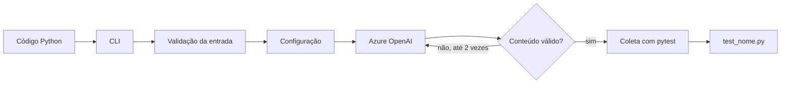

<div align="center">

# Agente Gerador de Testes pytest

**Transforme código Python em testes `pytest` usando LangChain e Azure OpenAI.**

Python 3.10+ · LangChain · Azure OpenAI · pytest · Hypothesis

[Instalação](#instalação) · [Como executar](#como-executar-o-agente) · [Exemplos](#exemplos-de-uso) · [Segurança](#notas-de-segurança)

</div>

---

## Descrição do projeto

O Agente Gerador de Testes pytest é uma ferramenta de linha de comando em Python. Ela recebe código Python (um arquivo, um trecho ou a entrada padrão) e usa LangChain com Azure OpenAI para gerar um arquivo de testes `test_<nome>.py`, pronto para ser executado com `pytest`.

O projeto é pessoal e educacional.

```text
meu_modulo.py  ──►  python -m pytest_agent  ──►  generated_tests/test_meu_modulo.py
```

## Funcionalidades

| Recurso | O que faz |
|---|---|
| **Várias fontes de entrada** | Lê um arquivo `.py`, a opção `--snippet` ou a entrada padrão (stdin). |
| **Validação antes do modelo** | Rejeita arquivo inexistente, entrada vazia, erro de sintaxe e mais de uma fonte, sem custo de API. |
| **Casos de sucesso e de falha** | Pede ao menos um teste de sucesso e um de falha (`pytest.raises`) por função pública. |
| **Limpeza da resposta** | Remove cercas Markdown e texto fora do código. |
| **Validação do resultado** | Começa com `import pytest`, é Python válido, tem funções `test_*` e um caso de falha. Pede correção ao modelo em até 2 novas tentativas. |
| **Verificação de coleta** | O arquivo gerado precisa importar o módulo alvo e passar em `pytest --collect-only` (veja a arquitetura). |
| **Gravação segura** | Grava em `generated_tests/` (ou no diretório escolhido) e pede confirmação antes de sobrescrever. |
| **Credenciais fora do código** | Lê as variáveis do Azure OpenAI do ambiente ou de um arquivo `.env`. |
| **Interface em português** | Mensagens de erro e ajuda em português. |

## Visão geral da arquitetura

O fluxo é: CLI, leitura e validação da entrada, carregamento da configuração, geração com o modelo, validação do conteúdo e gravação do arquivo.



| Módulo (`pytest_agent/`) | Responsabilidade |
|---|---|
| `cli.py` | Argumentos, mensagens de erro e orquestração geral |
| `input_reader.py` | Leitura e verificação do código de entrada |
| `config.py` | Carregamento das variáveis de ambiente e do `.env` |
| `prompt.py` | Construção das mensagens enviadas ao modelo |
| `llm_client.py` | Chamada ao Azure OpenAI via LangChain (temperatura 0, limite de 60 s) |
| `validator.py` | Extração do código e validação do arquivo de teste |
| `collection_check.py` | Verificação de coleta com `pytest --collect-only` |
| `generator.py` | Laço de geração com até 2 novas tentativas |
| `writer.py` | Nome do arquivo, confirmação de sobrescrita e gravação |
| `errors.py` | Erros do domínio com código de saída |

> [!NOTE]
> **Verificação de coleta:** além da validação do conteúdo, os testes gerados devem importar o módulo alvo e passar em `pytest --collect-only`. Essa verificação roda em um subprocesso, com limite de 30 s. Ela executa o código de nível superior do módulo alvo e do arquivo gerado, portanto revise o código antes de usar, principalmente se ele vier de terceiros.

## Pré-requisitos

- Python 3.10 ou superior.
- Um recurso Azure OpenAI com um deployment de modelo de chat criado.
- Chave de API, endpoint e versão da API desse recurso.

## Instalação

Execute os passos a partir da raiz do repositório.

1. Crie o ambiente virtual.

   PowerShell (Windows):

   ```powershell
   python -m venv .venv
   ```

   bash (Linux/macOS):

   ```bash
   python3 -m venv .venv
   ```

2. Ative o ambiente virtual.

   PowerShell (Windows):

   ```powershell
   .\.venv\Scripts\Activate.ps1
   ```

   bash (Linux/macOS):

   ```bash
   source .venv/bin/activate
   ```

3. Instale as dependências.

   PowerShell (Windows):

   ```powershell
   pip install -r requirements.txt
   ```

   bash (Linux/macOS):

   ```bash
   pip install -r requirements.txt
   ```

4. Copie o modelo de variáveis de ambiente para `.env`.

   PowerShell (Windows):

   ```powershell
   Copy-Item .env.example .env
   ```

   bash (Linux/macOS):

   ```bash
   cp .env.example .env
   ```

5. Abra o `.env` e substitua os valores de exemplo pelos dados reais do seu recurso.

## Configuração das variáveis de ambiente

O arquivo `.env.example` lista as quatro variáveis abaixo. Variáveis já definidas no ambiente do sistema têm prioridade sobre os valores do `.env`.

| Variável | Finalidade | Onde encontrar no portal do Azure |
|---|---|---|
| `AZURE_OPENAI_API_KEY` | Chave de API usada para autenticar as chamadas | Recurso Azure OpenAI, página "Keys and Endpoint" (Chaves e Ponto de Extremidade), campo "KEY 1" ou "KEY 2" |
| `AZURE_OPENAI_ENDPOINT` | URL base do recurso Azure OpenAI | Recurso Azure OpenAI, página "Keys and Endpoint", campo "Endpoint" |
| `AZURE_OPENAI_API_VERSION` | Versão da API usada nas chamadas (por exemplo `2024-06-01`) | Documentação de referência da API do Azure OpenAI; a versão deve ser compatível com o seu deployment |
| `AZURE_OPENAI_DEPLOYMENT_NAME` | Nome do deployment do modelo de chat | Azure AI Foundry, página "Deployments" (Implantações), coluna "Name" |

Se alguma variável estiver ausente, vazia ou só com espaços, o Agente lista os nomes que faltam, indica o arquivo `.env.example` e encerra com código 1 sem chamar o modelo.

## Como executar o Agente

Sintaxe geral, com o ambiente virtual ativo:

```bash
python -m pytest_agent [arquivo] [--snippet TEXTO] [--module-name NOME] [--output-dir DIR] [--force] [-h]
```

| Argumento | Descrição |
|---|---|
| `arquivo` | Caminho de um arquivo `.py` com o código a ser testado |
| `--snippet TEXTO` | Trecho de código passado diretamente na linha de comando |
| `--module-name NOME` | Nome do módulo; obrigatório para `--snippet` e para entrada padrão |
| `--output-dir DIR` | Diretório de saída (padrão: `generated_tests/`); é criado se não existir |
| `--force` | Sobrescreve o arquivo de teste existente sem pedir confirmação |
| `-h`, `--help` | Mostra a ajuda em português e sai |

Use apenas uma fonte de entrada por execução (arquivo, `--snippet` ou entrada padrão).

Opções abreviadas não são aceitas: escreva o nome completo da opção. Por exemplo, `--forc` é rejeitado com código de saída 2 em vez de ser interpretado como `--force`.

**Comportamento de sobrescrita**

- Se `test_<nome>.py` já existir e `--force` não for usado, o Agente pergunta se deve sobrescrever. Somente `s` ou `sim` confirma; qualquer outra resposta cancela e mantém o arquivo atual.
- Sem terminal interativo (CI, entrada redirecionada ou código vindo da entrada padrão), a falta de confirmação é tratada como recusa: o arquivo existente não é alterado, o Agente informa que `--force` é necessário e encerra com código diferente de zero.
- A confirmação acontece antes da chamada ao modelo, e o arquivo existente só é substituído depois que o novo conteúdo for validado.

**Códigos de saída**

| Código | Significado |
|---|---|
| `0` | Sucesso |
| `1` | Erro tratado (entrada, configuração, modelo, validação ou saída) |
| `2` | Erro de uso dos argumentos |

## Exemplos de uso

Os exemplos ficam em `examples/`: `calculadora.py` (funções `add` e `subtract`) e `divisao.py` (função `divide`, que lança `ValueError` quando o divisor é zero). Os testes gerados e versionados ficam em `examples/generated_tests/`.

Gerar os testes de cada exemplo, a partir da raiz do repositório:

```bash
python -m pytest_agent examples/calculadora.py --output-dir examples/generated_tests
python -m pytest_agent examples/divisao.py --output-dir examples/generated_tests
```

Como os arquivos `test_calculadora.py` e `test_divisao.py` já existem nesse diretório, o Agente pede confirmação antes de sobrescrever. Sem resposta afirmativa, o conteúdo versionado permanece intacto. Para regenerar sem a pergunta, acrescente `--force`.

Outros usos:

```bash
# Um arquivo qualquer, com saída em generated_tests/
python -m pytest_agent meu_modulo.py

# Um trecho de código (o nome do módulo é obrigatório)
python -m pytest_agent --snippet "def dobro(x): return x * 2" --module-name dobro
```

```bash
# Código pela entrada padrão (bash); a sobrescrita exige --force
cat meu_modulo.py | python -m pytest_agent --module-name meu_modulo --force
```

## Como rodar os testes com pytest

Na raiz do repositório, sem definir `PYTHONPATH`:

```bash
python -m pytest
```

O `pyproject.toml` configura o `pytest` para executar `tests/` (testes do próprio Agente) e `examples/` (testes gerados dos exemplos). Os testes do Agente usam um LLM falso, bloqueiam conexões de rede e não precisam de credenciais do Azure.

O `requirements.txt` usa faixas de versão (por exemplo `pytest>=9.2.0,<10`), que aceitam atualizações compatíveis dentro da mesma versão principal.

**Integração contínua:** o workflow `.github/workflows/ci.yml` roda `python -m pytest` a cada push e pull request. O passo "Verificar nomes proibidos" só é executado quando o secret `FORBIDDEN_NAMES` do repositório está configurado (um nome por linha). Sem o secret, esse passo é ignorado.

## Estrutura do projeto

```text
Azure-LangChain/
├── pytest_agent/            # Código do Agente
├── examples/
│   ├── calculadora.py
│   ├── divisao.py
│   └── generated_tests/     # Testes gerados e versionados dos exemplos
├── tests/                   # Testes do próprio Agente
├── scripts/                 # Scripts de apoio
├── .github/workflows/       # Integração contínua (ci.yml)
├── .env.example             # Modelo das variáveis de ambiente
├── .gitignore
├── pyproject.toml           # Configuração do pytest
├── requirements.txt
└── README.md
```

## Notas de segurança

> [!WARNING]
> Nunca versione o arquivo `.env` nem qualquer segredo (chaves de API, endpoints com chave, tokens). O `.env` deve estar listado no `.gitignore`, como já está neste repositório. Se uma chave vazar, gere uma nova no portal do Azure.

> [!CAUTION]
> Os testes são gerados por um LLM e podem estar incorretos ou ser inseguros. Revise o código gerado antes de executá-lo, principalmente quando o código de entrada vier de terceiros.

- O Agente nunca imprime o valor de `AZURE_OPENAI_API_KEY` em saídas, logs ou mensagens de erro.

## Licença

Este repositório ainda não inclui um arquivo de licença. Antes de reutilizar ou redistribuir o código, consulte o autor do projeto.